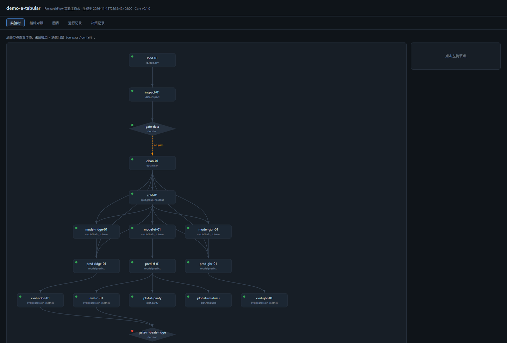
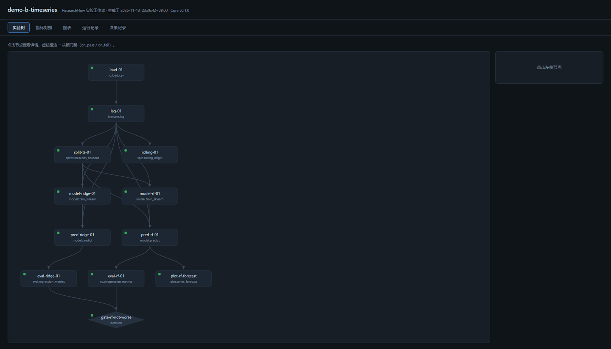
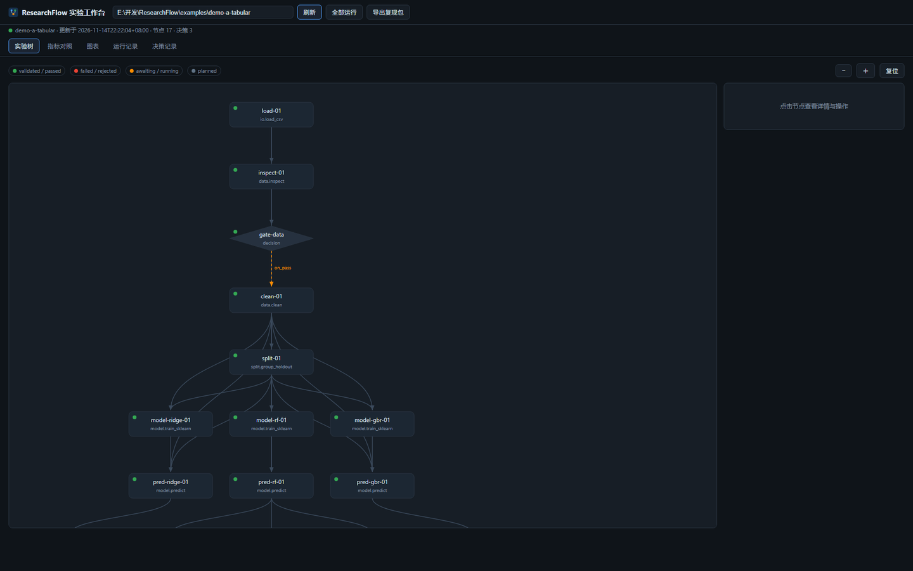
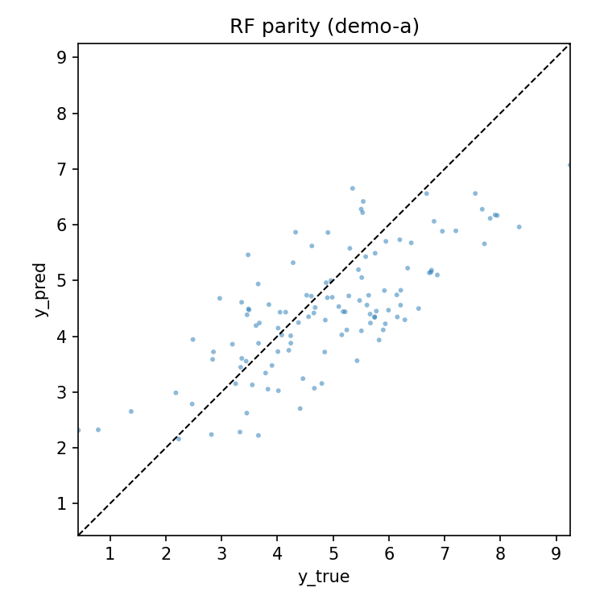
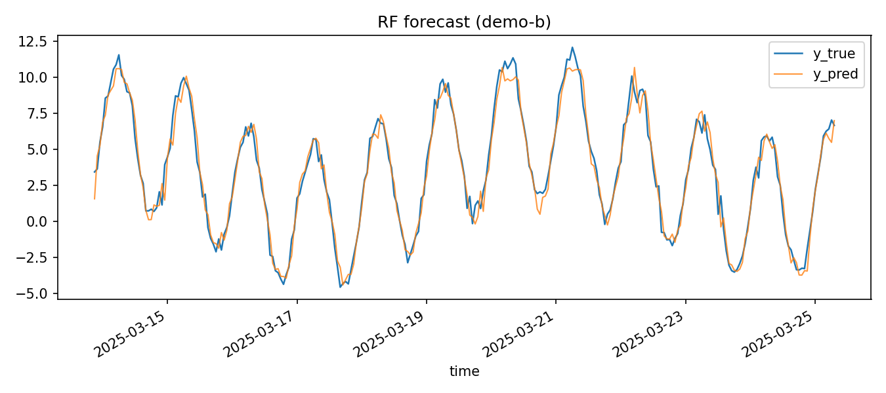
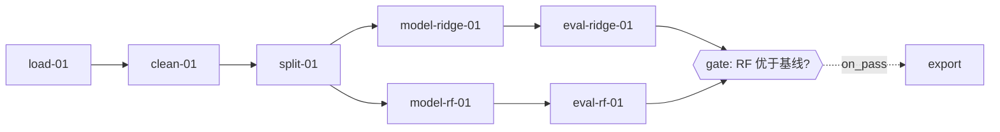
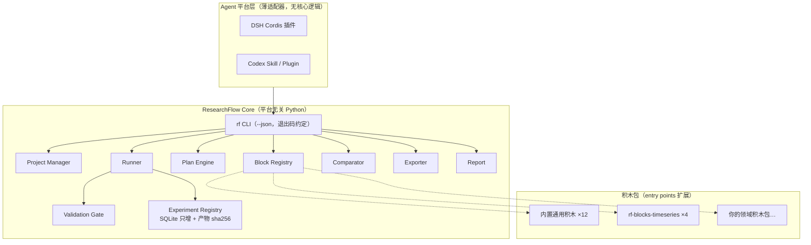

<p align="center">
  
</p>

<h1 align="center">ResearchFlow</h1>

<p align="center">
  <strong>把科研建模过程，变成可组合、可验证、可追溯的实验工作树。</strong><br>
  <em>Composable, verifiable, traceable research experiment trees — for DSH, Codex, and beyond.</em>
</p>

<p align="center">
  
  
  
  
  
</p>

---

## 为什么是 ResearchFlow？

科研 Agent 可以不断生成代码，但很难保证每一次实验与前一次实验在
**数据、方法、评价标准和结果**上具有可靠的继承关系：

- 每个会话重新发明数据划分与评价方式，结果之间不可比；
- 实验状态散落在对话历史里，换会话即丢失；
- "新方法真的比基线好吗"缺乏统一、留痕的判定；
- 投稿前无法回答"这张图是从哪份数据、哪段代码、哪次运行来的"。

ResearchFlow 的答案是三个一等公民：

| 概念 | 解决的问题 |
| --- | --- |
| 🧱 **Scientific Blocks** | 科研方法积木化：契约明确、可复用、可验证 |
| 🌲 **Experiment Tree** | 持续探索、比较、回退，研究决策显式留痕 |
| 🔗 **Research Provenance** | 数据 → 配置 → 代码 → 运行 → 图表的完整证据链 |

## 实景

**HTML 实验工作台**（`rf report` 一条命令生成，单文件、零依赖、离线可开）：

<p align="center">
  <br>
  <sub>表格回归 demo：17 节点实验树。绿点 = validated，橙菱形 = 决策节点，橙虚线 = 门禁边；点击节点看指标、验证器与产物哈希。</sub>
</p>

<p align="center">
  <br>
  <sub>时序回归 demo：滞后特征 → 时序防泄漏划分 → 双模型对照 → 决策通过。</sub>
</p>

**DSH 在线工作台**（`adapters/dsh-workbench` 插件提供，独立页面 + 应用内悬浮球入口）：

<p align="center">
  <br>
  <sub>五标签实时工作台：实验树（缩放/运行/决策）、指标对照、图表、运行记录、决策日志，支持导出复现包。</sub>
</p>

**实验产物直接就是论文素材：**

<p align="center">
  
  <br>
  <sub>左：Demo A parity 图（plot.parity 积木产物）；右：Demo B 真实 vs 预测序列（plot.series_forecast 积木产物）。</sub>
</p>

## 核心概念

### 🧱 积木：有契约的科研方法模块

每个积木声明 **inputs（数据端口）→ outputs（产物端口）+ params（配置）+ validation（成功判据）**。
接线类型不符、参数越界、版本不匹配 → **执行前拒绝**；运行后验证门禁不过 → **下游自动阻断**。

```yaml
id: split.group_holdout
category: data_split
inputs:  {dataset: {type: table}}
outputs: {train_indices: {type: indices}, test_indices: {type: indices}}
params:  {group_column: {type: string}, test_size: {default: 0.2}, seed: {default: 42}}
validation: [non_empty_splits, no_group_overlap]   # 防分组泄漏，机器说了算
execution: {deterministic: true, requires_approval: false}
```

内置 **12 个通用积木**（io / 清洗 / 划分 / 特征 / 训练 / 评价 / 绘图）+
时序积木包 **4 个**（entry points 独立分发）。模型 = 一个通用训练积木 +
`configs/*.yaml`：**换模型只改配置，不复制代码**。

### 🌲 工作树：执行节点 + 决策节点



决策节点支持 `auto`（判据表达式自动求值）、`manual`（人工确认）、
`auto_then_manual`（机器建议、人拍板）——**科研判断是流程的一等公民**，不是聊天里的口头约定。

### 🔗 证据链：每次运行都是独立 Run 记录

```json
{
  "run_id": "RUN-000021",
  "block": {"id": "model.train_sklearn", "version": "0.1.0", "source_sha256": "…"},
  "inputs":  {"dataset": {"sha256": "…"}, "train_indices": {"sha256": "…"}},
  "code":    {"git_commit": "0e7cd44", "git_dirty": false},
  "env":     {"python": "3.13.9", "packages_digest": "…"},
  "validations": [{"name": "file_exists", "passed": true}]
}
```

`rf export --verify` 会把选定节点连同上游链导出为**可独立复现的研究包**，
并在包内重跑、逐项比对指标容差——通过才盖章 verified。

## 快速开始

```sh
git clone https://github.com/YueQiandesedianzi/researchflow.git
cd researchflow
pip install -e .                              # Core（提供 rf CLI）
pip install -e packages/rf-blocks-timeseries  # 时序积木包

cd examples/demo-a-tabular
rf run --all --yes                            # 运行整棵实验树
rf compare eval-ridge-01 eval-rf-01 eval-gbr-01 --baseline eval-ridge-01
rf report                                     # 打开 HTML 实验工作台
rf export --nodes eval-rf-01,plot-rf-parity --out dist/paper-rf --verify
```

在你自己的项目里：`rf init --template tabular`（或 `timeseries`），
把数据放进 `data/`，编辑 `plan.yaml`，然后 `rf plan validate && rf run --all --yes`。

## 平台适配

Core 不知道 Agent 的存在；一切能力经 `rf --json` CLI（退出码 0/2/3/4）暴露，适配器保持最薄。

| 平台 | 形态 | 状态 |
| --- | --- | --- |
| **任意 Agent / 终端** | `rf` CLI + `AGENTS.md` 工作规范 | ✅ |
| **Codex** | Skill 原型（`.agents/skills/researchflow/`，渐进披露） | ✅ [adapters/codex](adapters/codex) |
| **DSH（DeepSeek Harness）** | Cordis 插件：9 个 Agent Tools + `/researchflow` 命令 | ✅ [adapters/dsh](adapters/dsh) |
| **Codex Plugin + MCP** | `.codex-plugin/plugin.json` + `researchflow-mcp`（9 工具，协议级测试通过） | ✅ [adapters/codex/plugin](adapters/codex/plugin) |
| **DSH 可视化工作台** | `shell.overlay` 抽屉面板 + 独立页面 `/researchflow`：运行节点、决策按钮、实时刷新 | ✅ [adapters/dsh-workbench](adapters/dsh-workbench) |

## 架构



## 验收与测试

两个独立 demo 项目证明通用性（同一套基础积木跨任务复用 75%）：
[demo-a-tabular](examples/demo-a-tabular)（分组防泄漏 + 三模型对照 + 双决策节点）、
[demo-b-timeseries](examples/demo-b-timeseries)（滞后特征 + 时序防泄漏 + 滚动原点验证）。

| # | 验收标准 | 实证 |
| --- | --- | --- |
| 1 | 不依赖特定数据集 | 两个独立合成数据集 demo |
| 2 | 组合 ≥3 类积木 | demo 用到 6 个 category |
| 3 | 生成保存工作树 | `plan.yaml` + validate/show |
| 4 | 记录输入/输出/状态 | run.json + SQLite 索引 |
| 5 | 阻止契约不符执行 | 类型错接 → 退出码 2 |
| 6 | 按记录复现结果 | `export --verify` 重跑比对通过 |
| 7 | 两任务共享基础积木 | 12/16 跨 demo 复用 |
| 8 | Core 零平台依赖 | 纯 Python，无 DSH/Codex import |

**89 项测试全绿**（单元 / 契约 / 集成 / 端到端 / 适配器 walkthrough）：`python -m pytest -q`

## Roadmap

| 版本 | 交付 | 状态 |
| --- | --- | --- |
| V0.1 | Core + CLI + 16 积木 + 双 demo | ✅ |
| V0.2 | Codex Skill 原型 | ✅ |
| V0.3 | DSH Cordis 插件（Agent Tools + 命令） | ✅ |
| V0.4 | Codex Plugin + MCP server | ✅ |
| V1.0 | DSH 可视化实验工作台（overlay 面板 + 独立页面） | ✅ |

## 文档

| 文档 | 内容 |
| --- | --- |
| [docs/00-research.md](docs/00-research.md) | DSH / Codex 插件机制与现有编排项目调研 |
| [docs/01-prd.md](docs/01-prd.md) | 产品需求文档 |
| [docs/02-architecture.md](docs/02-architecture.md) | 核心架构与模块依赖 |
| [docs/03-block-schema.md](docs/03-block-schema.md) | 积木契约 Schema 与 MVP 积木清单 |
| [docs/04-experiment-tree.md](docs/04-experiment-tree.md) | 工作树、Run 记录与持久化方案 |
| [docs/05-platform-adapters.md](docs/05-platform-adapters.md) | 平台适配器设计 |
| [docs/06-mvp-plan.md](docs/06-mvp-plan.md) | MVP 计划、测试、异常恢复与版本兼容 |

## License

[MIT](LICENSE) © 2026 ResearchFlow contributors
