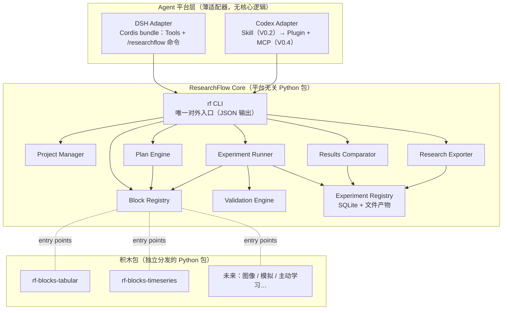
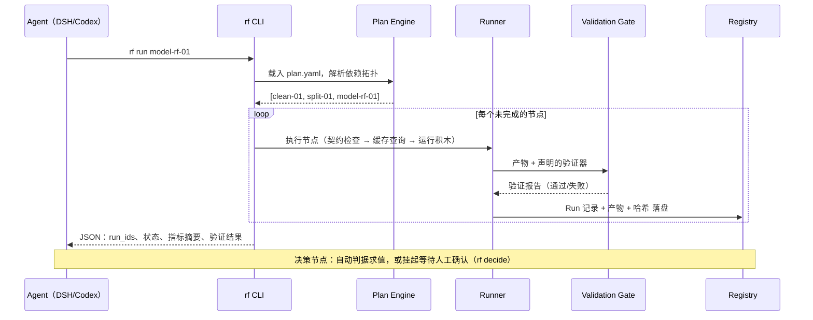

# 02 — 核心架构与模块依赖

版本：v0.1-draft｜日期：2026-11-13

## 1. 分层总览



**依赖方向单向**：适配器 → CLI → Core 模块 → 积木契约。Core 不知道 Agent 的存在；
积木包只依赖 Core 的契约模块（`researchflow.blocks` 命名空间），不被 Core 依赖。

## 2. 模块职责

| 模块 | 职责 | 关键约束 |
| --- | --- | --- |
| **CLI** (`rf`) | 唯一对外入口；参数解析、JSON/文本输出、退出码规范 | 任何能力必须经 CLI 可达，适配器不做绕行 |
| **Project Manager** | `rf init` 生成/修复标准结构；项目配置读取；`rf doctor` 一致性检查 | 幂等，绝不覆盖用户已有文件 |
| **Block Registry** | 积木三级发现、Schema 校验、版本解析、契约检查 | 契约不符 → 拒绝执行（不是警告） |
| **Plan Engine** | plan.yaml 解析/校验/拓扑排序；执行节点 + 决策节点求值；Mermaid 渲染 | 计划=意图（可编辑），状态=Registry（只增不改），二者分离 |
| **Experiment Runner** | 依赖调度、子进程隔离执行积木、超时控制、确定性缓存、节点锁 | Runner 只执行 Registry 校验过的积木 |
| **Validation Engine** | 内置验证器库 + 积木自带 validate 钩子；产出验证报告 | 验证失败阻断下游，记录落盘 |
| **Experiment Registry** | Run 记录、产物哈希、SQLite 索引、状态查询 | 只增不改；Run 目录写一次后只读 |
| **Results Comparator** | 跨 Run/分支统一指标表、基线相对差、对照图数据 | 只读 Registry，不重跑实验 |
| **Research Exporter** | 选择节点 → 收集产物/配置/代码快照/环境/PROVENANCE → 复现包；`--verify` 重跑校验 | 导出包脱离原项目可独立复现 |

## 3. 一次运行的数据流



## 4. 关键设计决策

| # | 决策 | 理由 |
| --- | --- | --- |
| D1 | **计划与状态分离**：plan.yaml 是人和 Agent 共同编辑的意图；运行状态只在 Registry | 计划可自由演化/回退，历史 Run 永不失真；多会话协作无写冲突 |
| D2 | **Run 不可变**：产物目录写一次即只读；重跑 = 新 Run ID | 证据链可信；比较与导出永远指向确定状态 |
| D3 | **契约优先**：输入端口类型/版本不满足即拒绝执行 | 把"AI 瞎接管线"挡在执行前（验收标准 5） |
| D4 | **决策节点是一等公民**：科研判断（是否过拟合、是否优于基线）显式建模，支持自动判据与人工确认 | 这是科研工作流与普通流水线的本质区别 |
| D5 | **内容寻址缓存只服务确定性积木**：`sha256(block源码 + 参数 + 输入产物)` 命中即复用 | 省算力且不牺牲可复现性；非确定性积木必须显式声明 |
| D6 | **Core 对 Agent 透明**：全部交互经 CLI 的有界 JSON | 适配器最薄；平台升级不伤核心；Shell 可直达便于调试 |
| D7 | **不重造编排器**：并行试错交给 dsh_workflow 等，留 `rf run` 被外部编排的集成点 | 聚焦科研语义差异化（见 [00-research](00-research.md) 第 3 节） |
| D8 | **配置驱动模型**：模型 = 通用训练积木 + 配置文件（如 `configs/rf.yaml`），不为每个模型复制脚本 | 消除"改一处漏三处" |

## 5. Core 仓库结构（V0.1 目标）

```text
researchflow/
├── pyproject.toml
├── src/researchflow/
│   ├── cli.py               # 入口：rf
│   ├── project.py           # Project Manager（init / doctor）
│   ├── blocks/
│   │   ├── schema.py        # block.yaml JSON Schema 校验
│   │   ├── loader.py        # 三级发现 + 版本解析
│   │   ├── contract.py      # 端口类型系统 + 契约检查
│   │   └── validators.py    # 内置验证器
│   ├── plan/
│   │   ├── model.py         # Plan / Node / Edge / Decision 数据结构
│   │   ├── engine.py        # 校验、拓扑、Mermaid 渲染
│   │   └── decisions.py     # 自动判据求值、人工确认流
│   ├── runner/
│   │   ├── executor.py      # 调度 + 子进程执行 + 超时
│   │   └── cache.py         # 内容寻址缓存
│   ├── validation/gate.py   # Validation Engine
│   ├── registry/
│   │   ├── store.py         # SQLite 读写（只增不改）
│   │   ├── schema.sql       # 表结构 + migrations
│   │   └── artifacts.py     # 产物落盘 + sha256
│   ├── compare/compare.py   # Results Comparator
│   └── export/exporter.py   # Research Exporter（含 --verify）
│   └── blocks_builtin/      # 内置通用积木（io、metrics、plot，随包分发）
│   └── templates/           # rf init 模板（AGENTS.md、plan、模型配置）
├── packages/rf-blocks-*/    # 独立分发的积木包（entry points 注册）
├── tests/
└── docs/                    # 本文档包
```

> 实现注记：V0.1 将内置积木放在包内 `blocks_builtin/`（经 importlib 路径发现），
> 替代原计划的仓库根 `blocks-core/`，保证 pip 安装后任意工作目录可用。

## 6. 与适配器的接口约定

CLI 全部命令支持 `--json`： stdout 输出**有界 JSON**（大结果给路径不内联），
stderr 给人读文本；退出码：`0` 成功，`2` 契约/校验失败，`3` 运行失败，
`4` 需要人工决策/审批挂起。适配器只依赖该约定与命令面（见
[05-platform-adapters](05-platform-adapters.md)）。

## 7. AGENTS.md（Project Init 生成）

`rf init` 生成的 AGENTS.md 同时服务 DSH 与 Codex 会话，要点：

1. 本项目的实验一律经 `rf` CLI 执行，禁止手写脚本直接改 `.researchflow/`；
2. 新增实验 = 编辑 plan.yaml + 复用/新增积木，禁止复制既有脚本改参数；
3. 决策节点未通过前，不得将其下游结果用于论文；
4. 常用命令清单（init/run/status/compare/export）与积木目录查询方式。
